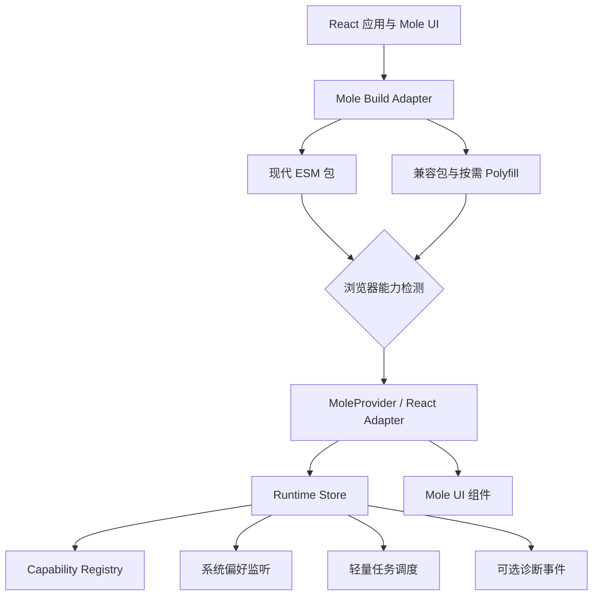

# Mole Runtime Engine 设计方案

状态：Implemented（v1）  
适用范围：Mole UI React 18 / React 19  
目标版本：Mole UI 0.2.x

当前实现：Runtime Core、React Hooks、`MoleProvider` 集成、轻量调度器、`DeferredRender`、ES2018 组件产物、Browserslist、Autoprefixer，以及 Vite 现代/兼容双构建。真实国产浏览器与 WebView 设备矩阵仍需在发布流程中持续执行。

## 1. 目标

Mole Runtime Engine 是 Mole UI 的轻量运行与兼容层。它不替代 React，也不实现新的渲染器；它只处理组件库自身无法通过普通组件 API 稳定解决的共性问题：

- 让生产应用在现代浏览器中保持小体积和流畅交互。
- 为国内外较旧的 Chromium、Firefox、Safari、Android WebView 提供兼容构建和能力降级。
- 统一主题、密度、动态效果、输入设备及无障碍环境的运行策略。
- 保持服务端渲染安全，不在模块初始化阶段访问 `window` 或 `document`。
- 给组件提供稳定的能力接口，避免每个组件自行判断浏览器或复制监听器。

首版不追求支持 IE，也不根据“360、QQ、UC”等品牌字符串决定行为。国产浏览器经常存在多内核或内核版本与产品版本不一致的情况，因此运行行为以能力检测为准，品牌信息只用于诊断。

## 2. 非目标

- 不替代 React reconciliation、DOM 渲染或事件系统。
- 不内置路由、数据请求、状态管理、表单方案或国际化词典。
- 不强制给所有用户加载完整 Polyfill 集合。
- 不把业务监控 SDK 打包进 `moledao`。
- 不保证任何浏览器中的像素级完全一致；降级版本应保证内容、操作和语义一致。

## 3. 总体结构

引擎由构建期兼容层和浏览器运行时组成。只有浏览器运行时会进入最终业务包。



### 3.1 Mole Build Adapter

构建层解决浏览器在 React 启动前遇到的问题：JavaScript 语法、模块格式、CSS 前缀和必要的 Polyfill。

- Playground 使用 Vite 官方 legacy 插件输出现代包与兼容包。
- 目标浏览器由仓库根目录的 Browserslist 统一声明。
- 组件包的发布产物降至经过测试的语法目标；ESM/CJS 导出结构保持不变。
- CSS 使用 Autoprefixer，并对无法自动转换的特性设置静态检查。
- Polyfill 根据构建目标与实际代码使用生成，现代浏览器不下载兼容包。

构建层不属于运行时包，不能增加业务应用的常驻开销。

### 3.2 Runtime Store

Runtime Store 是一个小型外部状态源。它保存浏览器能力和会变化的系统偏好，并通过 `useSyncExternalStore` 与 React 连接。

- 每个应用显式拥有一个 Runtime 实例，不使用隐藏的全局单例。
- `getServerSnapshot()` 返回稳定、保守的服务端快照。
- 浏览器检测只在 `start()` 或首次订阅时执行。
- 最后一个订阅者退出后移除 `matchMedia` 等监听器。
- 快照字段没有变化时保持引用稳定，避免 Provider 子树整体重渲染。

### 3.3 Capability Registry

首版只检测组件实际使用的能力，不建立庞大的浏览器特性数据库。

```ts
export interface MoleCapabilities {
  hover: boolean;
  coarsePointer: boolean;
  intersectionObserver: boolean;
  resizeObserver: boolean;
  inert: boolean;
  focusVisible: boolean;
}

export interface MolePreferences {
  colorScheme: 'light' | 'dark';
  contrast: 'normal' | 'more';
  forcedColors: boolean;
  reducedMotion: boolean;
}
```

检测规则：

- DOM API 使用 `'APIName' in globalThis`。
- CSS 能力使用 `CSS.supports()`。
- 输入方式和用户偏好使用 `matchMedia()`。
- User-Agent 不参与功能分支；只允许写入可选诊断事件。

### 3.4 React Adapter

现有 `MoleProvider` 保持兼容，新增的配置全部可选。

```tsx
import {
  createMoleRuntime,
  MoleProvider,
  type MoleRuntimeEvent,
} from 'moledao';

const runtime = createMoleRuntime({
  compatibility: 'auto',
  onDiagnostic(event: MoleRuntimeEvent) {
    // 由业务方决定是否发送到自己的监控系统。
  },
});

root.render(
  <MoleProvider
    density="comfortable"
    locale="zh-CN"
    motion="system"
    runtime={runtime}
    theme="system"
  >
    <App />
  </MoleProvider>,
);
```

建议的公共接口：

```ts
export type MoleCompatibilityMode = 'auto' | 'modern' | 'compatible';
export type MoleMotionMode = 'system' | 'full' | 'reduced';

export interface MoleRuntimeOptions {
  compatibility?: MoleCompatibilityMode;
  onDiagnostic?: (event: MoleRuntimeEvent) => void;
}

export interface MoleRuntimeSnapshot {
  capabilities: Readonly<MoleCapabilities>;
  preferences: Readonly<MolePreferences>;
  ready: boolean;
}

export interface MoleRuntime {
  getServerSnapshot(): MoleRuntimeSnapshot;
  getSnapshot(): MoleRuntimeSnapshot;
  schedule(
    priority: 'visual' | 'background',
    task: () => void,
    options?: { timeout?: number },
  ): () => void;
  start(): void;
  subscribe(listener: () => void): () => void;
  stop(): void;
}

export function createMoleRuntime(options?: MoleRuntimeOptions): MoleRuntime;
export function useMoleRuntime(): MoleRuntimeSnapshot;
export function useMoleCapability(name: keyof MoleCapabilities): boolean;
export function useMolePreference<K extends keyof MolePreferences>(
  name: K,
): MolePreferences[K];
```

Provider 输出稳定的数据属性，CSS 可以直接响应运行环境，不要求每个组件订阅 React 状态：

```html
<div
  class="mole-provider"
  data-mole-density="comfortable"
  data-mole-forced-colors="false"
  data-mole-motion="reduced"
  data-mole-pointer="coarse"
  data-mole-theme="dark"
>
</div>
```

## 4. 运行模式

### `auto`（默认）

- 根据能力和系统偏好选择组件行为。
- 不使用浏览器品牌判断。
- 动态效果遵循 `prefers-reduced-motion`。

### `modern`

- 面向受控环境，例如桌面端内部系统或已知版本的 WebView。
- 允许组件假定现代能力存在，缺少能力时仍须保持基本可用。

### `compatible`

- 主动关闭非必要的复杂动画和高成本视觉效果。
- 使用事件、定位与观察器的保守实现。
- 适合业务已知存在较多旧内核用户的场景。

运行模式只决定交互策略。JavaScript 是否能被浏览器解析，仍由构建期兼容层保证。

## 5. 调度与性能模型

首版不引入通用任务调度框架，只提供两个内部调度通道：

- `visual`：在下一帧执行 DOM 测量或视觉更新，底层使用 `requestAnimationFrame`。
- `background`：优先使用 `requestIdleCallback`，不可用时回退到带超时的 `setTimeout`。

约束：

- 输入、点击、焦点和表单更新不得进入后台队列。
- 同一组件同一帧的重复视觉任务必须合并。
- DOM 读取和写入分阶段执行，避免强制同步布局。
- Runtime 不缓存业务数据，也不持有组件 DOM 节点。
- 组件优先使用 CSS 完成动画；JavaScript 只负责编排状态。

体积预算：

| 产物 | Gzip 上限 |
| --- | ---: |
| Runtime Core | 2 KB |
| React Adapter 与 Hooks | 1 KB |
| 单个可选能力适配器 | 1.5 KB |
| 现代构建强制 Polyfill | 0 KB |

## 6. 兼容策略

### 6.1 支持等级

| 等级 | 范围 | 承诺 |
| --- | --- | --- |
| A 现代增强 | Vite 当前现代目标及更新浏览器 | 完整视觉与交互 |
| B 兼容 | Browserslist 覆盖的旧 Chromium、Firefox ESR、Safari/iOS 和 WebView | 完整内容、操作与无障碍语义，允许视觉降级 |
| C 基础提示 | IE、过旧 Android 浏览器、禁用 JavaScript | 静态内容或升级提示，不保证 React 交互 |

建议的初始 Browserslist 策略：

```text
> 0.2%
> 0.2% in CN
last 2 versions
Firefox ESR
not dead
not IE 11
```

上线后用真实访问数据替代纯市场份额假设。浏览器品牌不作为支持合同；支持合同记录浏览器内核、操作系统与关键能力。

### 6.2 CSS 原则

- CSS Variables 是最低样式能力边界，因此 IE 不在支持范围内。
- `:has()`、容器查询等能力不能出现在核心交互的唯一实现中。
- 使用 `@supports` 渐进增强；基础规则必须先提供可用布局。
- `forced-colors` 和高对比度下不得只靠背景图表达状态。
- 动画必须提供 `prefers-reduced-motion` 分支。

### 6.3 Polyfill 原则

- 不修改原生原型，除非来自经过维护的标准 Polyfill 包。
- 首屏必需能力由兼容构建注入；非首屏能力由对应功能按需加载。
- `IntersectionObserver` 缺失时，文档导航退化为滚动事件节流或不自动高亮。
- `ResizeObserver` 缺失时，浮层优先使用固定策略或窗口 resize 回退。
- 每个 Polyfill 必须有删除条件和对应的浏览器测试。

## 7. 组件接入规则

组件默认不应读取完整 Runtime Snapshot。只订阅自己需要的单个能力：

```tsx
const reducedMotion = useMolePreference('reducedMotion');
```

新组件必须满足：

1. 模块导入在 Node.js 环境不访问 DOM。
2. 没有 Runtime Provider 时使用安全默认值。
3. 功能检测失败时仍能完成核心操作。
4. 不通过 User-Agent 切换渲染树。
5. 不因能力快照更新丢失焦点或表单值。
6. 受控与非受控模式行为一致。
7. 键盘、触摸、鼠标和辅助技术共享同一语义状态。

## 8. 诊断事件

诊断完全可选，引擎不发送网络请求，不读取业务数据。

```ts
export type MoleRuntimeEvent =
  | { type: 'runtime-ready'; duration: number }
  | { type: 'capability-missing'; capability: keyof MoleCapabilities }
  | { type: 'fallback-used'; component: string; feature: string }
  | { type: 'runtime-error'; error: unknown; source: string };
```

事件处理器由宿主应用提供。开发模式下可以输出一次性警告；生产环境默认静默。

## 9. 测试矩阵

### 每次提交

- Vitest：能力检测、订阅清理、SSR 快照、Provider 数据属性。
- React 18 与 React 19 类型及渲染测试。
- Playwright：Chromium、Firefox、WebKit 的核心组件交互。
- 构建检查：现代包、兼容包、ESM/CJS 导出和体积预算。
- 静态规则：禁止关键 CSS 只有现代特性实现。

### 每个版本

- 最新 Windows Edge/Chrome、macOS Safari、Firefox ESR。
- iOS Safari、Android Chrome 和 Android System WebView。
- 微信内置浏览器。
- 至少一个使用旧 Chromium 内核的 360/QQ/UC 环境。
- 键盘操作、屏幕阅读器、高对比度和减少动态效果检查。

国产浏览器与 WebView 应记录实际 Chromium/WebKit 内核版本，而不是只记录产品名称。

## 10. 文件结构

首版保留在现有 `moledao` 包内，避免增加发布和安装复杂度：

```text
packages/ui/src/runtime/
  capabilities.ts      # 无副作用的能力检测
  createRuntime.ts     # Runtime Store 生命周期
  diagnostics.ts       # 可选事件定义与派发
  hooks.ts             # 细粒度 React Hooks
  scheduler.ts         # 公开的 visual/background 轻量调度
  types.ts             # 公共类型
  index.ts             # moledao/runtime 入口

packages/ui/src/provider/
  MoleProvider.tsx     # 连接 Runtime 与现有主题/密度数据属性

apps/playground/src/compat/
  unsupported.tsx      # C 级浏览器基础提示
```

新增公开入口：

```text
moledao/runtime
```

根入口导出 `createMoleRuntime`、常用 Hooks、任务调度和类型。底层能力检测函数保持内部实现，防止形成难以演进的公共 API。

## 11. 实施顺序

### 阶段 1：兼容基线

- 增加 Browserslist 和自动前缀。
- Playground 接入现代/兼容双构建。
- 明确组件包发布语法目标。
- 移除文档页关键路径中的 `:has()` 依赖，为 `IntersectionObserver` 增加降级。

验收：兼容构建可在目标旧内核启动，现代构建体积增长不超过 2%。

### 阶段 2：Runtime Core

- 实现无副作用检测、Runtime Store 和生命周期。
- 实现 SSR 快照、系统主题、动态效果及输入设备监听。
- 增加 `moledao/runtime` 子路径导出。

验收：Core 小于 2 KB gzip；无 Provider 时所有现有组件行为不变。

### 阶段 3：React 集成

- 扩展 `MoleProvider`，增加 `runtime`、`locale` 和 `motion`。
- 实现细粒度 Hooks 与数据属性。
- 首批接入 Tooltip、Toggle 和 Spinner。

验收：能力变化不触发无关组件重渲染；减少动态效果和触摸模式行为正确。

### 阶段 4：浏览器门禁

- 增加 Playwright 浏览器矩阵、视觉回归和体积检查。
- 建立国产浏览器/WebView 人工验收清单。
- 将兼容矩阵和已知限制发布到组件文档。

验收：所有 A/B 级目标通过核心组件操作流程；C 级环境显示明确提示。

## 12. 关键决策

1. **构建兼容与运行时适配分离。** 避免把 Polyfill 和兼容判断常驻到所有现代用户的包中。
2. **能力检测优先。** 解决国产多内核浏览器和嵌入式 WebView 版本不透明的问题。
3. **不使用全局单例。** 支持测试、微前端、多根 React 应用和服务端渲染。
4. **细粒度订阅。** Provider 不因任一媒体查询变化而重渲染整个组件树。
5. **兼容是可用性合同，不是像素合同。** 旧内核允许视觉降级，但内容、操作和无障碍语义不能丢失。
6. **默认零网络行为。** 诊断由宿主选择接入，组件库不擅自上报。

## 13. 成功指标

- A/B 级浏览器核心组件交互通过率达到 100%。
- 现代构建首屏 JavaScript 不因兼容层增加超过 2%。
- Runtime Core 与 React Adapter 合计不超过 3 KB gzip。
- Runtime 初始化不产生长任务，目标耗时小于 2 ms。
- 切换主题、动态效果和输入设备时，无关组件不发生可测量重渲染。
- 线上 `capability-missing` 与 `fallback-used` 数据可以映射到实际内核版本并指导删除旧兼容代码。

## 参考

- [Vite：生产构建与浏览器兼容](https://v8.vite.dev/guide/build)
- [Vite：@vitejs/plugin-legacy](https://github.com/vitejs/vite/tree/main/packages/plugin-legacy)
- [Browserslist](https://github.com/browserslist/browserslist)
- [React：Client React DOM APIs](https://react.dev/reference/react-dom/client)
